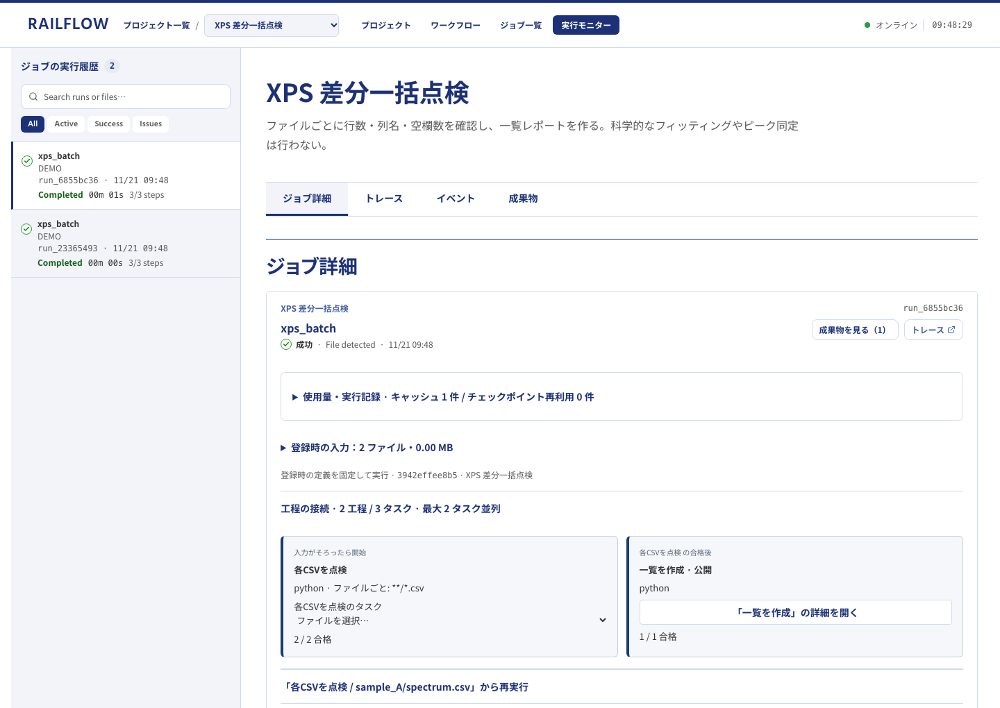
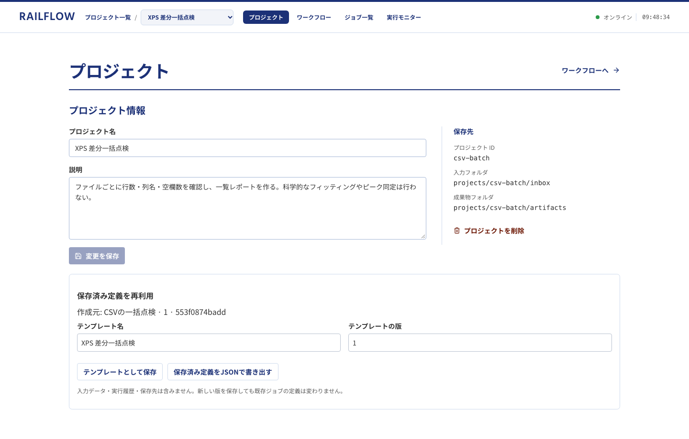
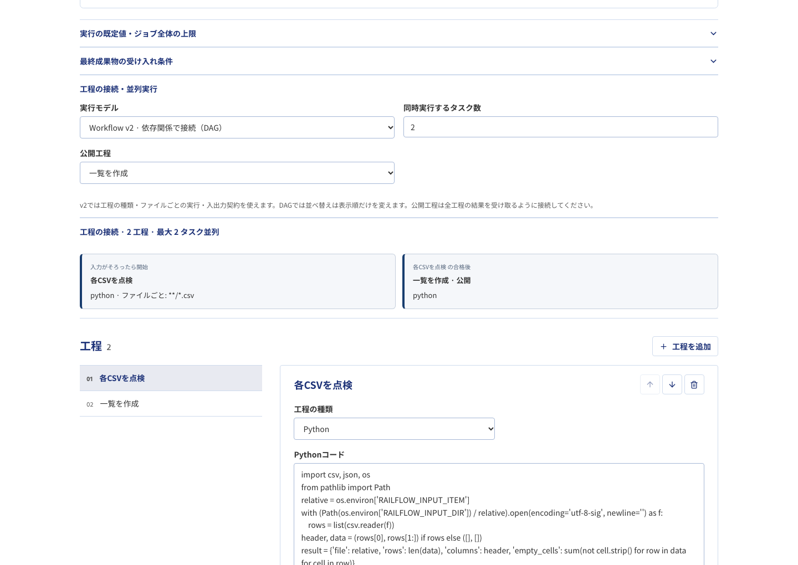
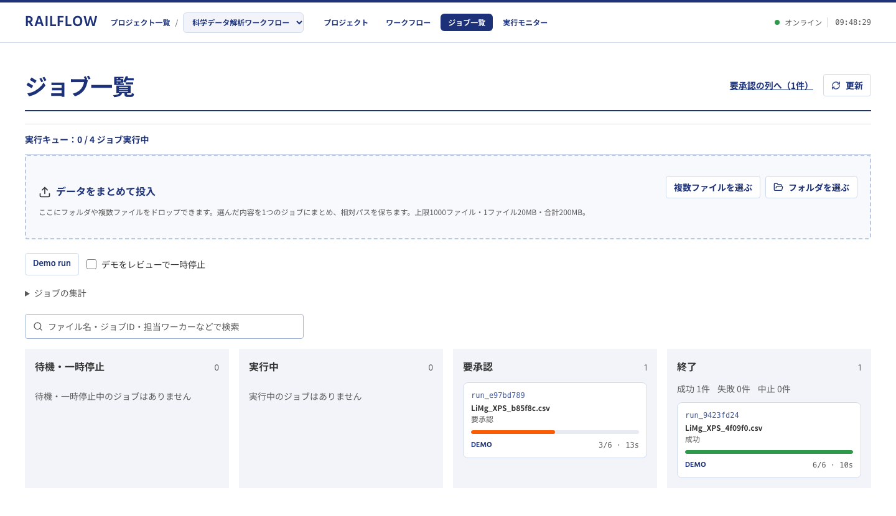
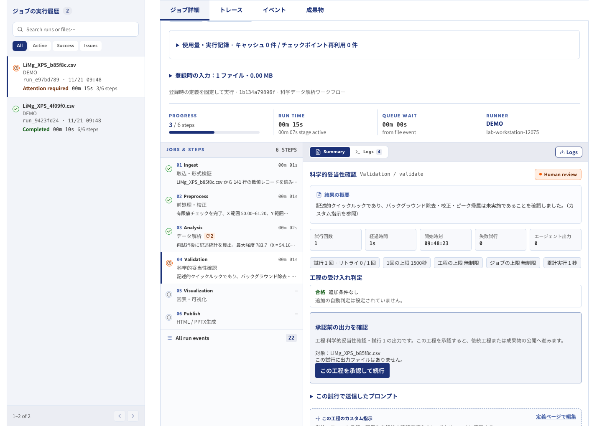
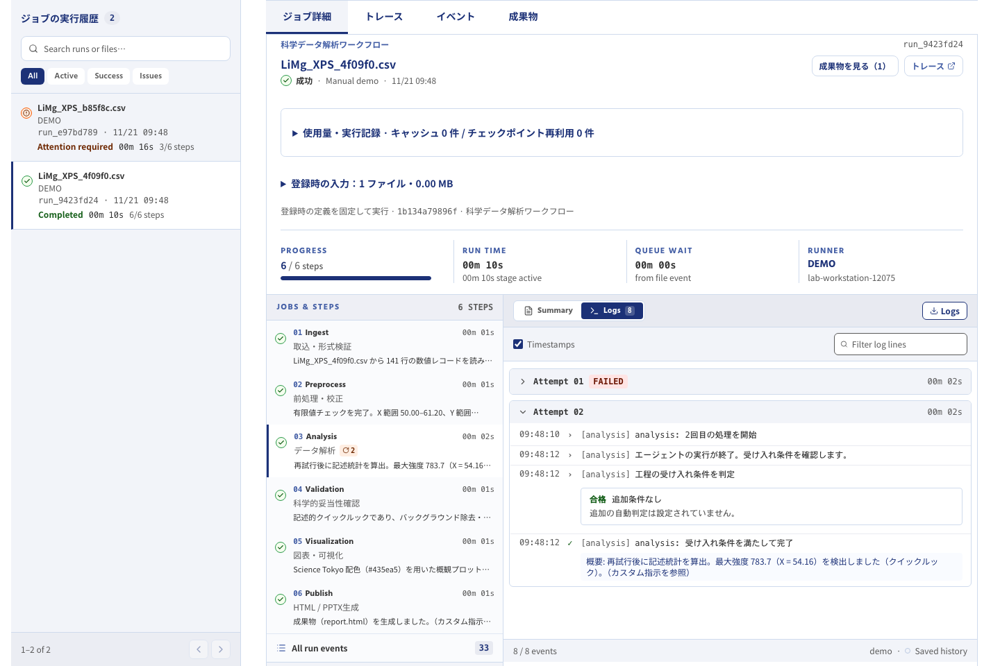

# RAILFLOW

[English](README.md)

RAILFLOW は実験データをローカルで解析し、工程ごとの結果や実行記録を確認するためのワークフロー実行・監視ツールです。プロジェクトごとに解析手順を定義すると、ワーカーが手順に沿って単一ファイル・複数ファイル・フォルダ全体を 1 つのジョブとして処理します。Codex CLI と Claude Code CLI に対応し、画面は Science Tokyo のデザインシステム（Noto Sans JP・Hind・Science Blue）に沿った配色と書体で構成しています。

> 公式ロゴについて: Science Tokyo Design System のガイドラインに従い、大学の公式ロゴ（Science S やロゴタイプ）は生成・同梱していません。



## デモを試す

Node.js 26 以上、pnpm 12、Python 3 を用意します。デモワーカーはローカルの Python スクリプトでレポートを作るため、Codex や Claude の認証は不要です。

```sh
pnpm install
pnpm run demo
```

1. ブラウザで [http://127.0.0.1:4173](http://127.0.0.1:4173) を開き、「プロジェクト一覧へ」から既定のプロジェクトを選びます。
2. 「ジョブ一覧」で「Demo run」を押します。XPS を模したサンプル CSV が投入され、そのジョブの実行モニターが開きます。
3. 「ジョブ詳細」で工程を選びます。「Summary」には結果の要約、「Logs」には試行ごとの記録が表示されます。既定のデモでは解析工程で一度失敗し、再試行する様子も確認できます。
4. 完了したら「成果物」で `report.html` を開きます。デモで使う Python 環境に `python-pptx` が入っていれば、`report.pptx` もダウンロードできます。

途中で人が確認する流れを試すには、投入前に「デモをレビューで一時停止」にチェックを入れます。Shift キーを押しながら「Demo run」を押しても同じ動作になります。レビュー待ちになったら、対象工程の出力を確認してから承認ボタンを押します。デモレポートは入力データの傾向を示すクイックルックであり、XPS のピークフィッティングや帰属は行いません。

## プロジェクトとテンプレート

「プロジェクト一覧」で「新規プロジェクト」を選び、名前と説明を入力して作成します。作成時は空の既定構成のほか、組み込みテンプレート（「CSVの一括点検」「AI解析と人間の確認」）、保存済みテンプレート、外部のテンプレート JSON を選べます。外部 JSON にコマンド・Python・HTTP 工程や指定 Python パスが含まれる場合は、実行内容の全文プレビューを確認し、同意チェックを入れてから作成します。



プロジェクトを開くと、ヘッダーに「プロジェクト」「ワークフロー」「ジョブ一覧」「実行モニター」が並びます。「プロジェクト」画面では名前・説明の編集、入力フォルダ・成果物フォルダの確認に加え、現在の保存済み定義に名前と版（バージョン）を付けてテンプレートとして保存したり、JSON で書き出したりできます。保存済みテンプレートは一覧から名前と版を確認して削除できます。テンプレートの書き出し・保存には入力データや実行履歴、ローカルの保存先パスを含みません。

## ワークフロー定義

「ワークフロー」画面では受け入れ要件や各工程の設定を編集し、「定義を保存」で反映します。編集中に別タブなどから同じプロジェクトが更新された場合は、編集中の下書きを保持したまま通知し、最新版の読み込みか明示的な上書き保存を選べます。未保存のままプロジェクトを切り替えたり画面を離れたりする際も確認が入ります。



### 実行モデルと工程の種類

既定の「従来の順次実行」に加え、Workflow v2 の「順次接続」と「依存関係で接続（DAG）」を選べます。既定の 6 工程（取込・形式検証、前処理・校正、データ解析、科学的妥当性確認、図表・可視化、レポート生成）は 1〜20 工程の範囲で追加・削除・並べ替えできます。

| 項目                     | 内容                                                                                           |
| ------------------------ | ---------------------------------------------------------------------------------------------- |
| 実行モデル               | 従来の順次実行 / Workflow v2（順次接続・DAG・最大 8 タスク並列）                               |
| 工程の種類（v2）         | AI（ワーカー既定・Codex・Claude）/ コマンド / Python / HTTP / 人間の承認                       |
| ファイル単位処理（map）  | パターンに一致するファイルごとにタスクを展開。「このファイルだけを入力に渡す」で入力を分離可能 |
| 入出力ファイル契約（v2） | パターンごとの件数範囲と JSON スキーマを検証。数値下限や配列要素などの制約も要約表示           |

実行モデルや工程の種類を切り替えながら編集しても下書きは保持され、互換性のない設定を破棄して保存する場合だけ、対象工程数と破棄内容を確認してから保存します。モデル名と推論の強さは、工程の設定、プロジェクトの設定、CLI の既定値の順で決まります。

### 入力と起動条件

「ワークフロー」の「入力と起動条件」では、監視フォルダの対象単位（単一ファイルのみ、直下のフォルダごと、または両方）と無変更の待機時間（既定 1.5 秒）を指定します。起動条件は「すべて満たす（AND）」「いずれかを満たす（OR）」「でない（NOT）」を入れ子にして組み立てられ、ファイルの存在、ファイル数、合計バイト数、テキスト内容、JSON の値、データセット名、無変更時間を比較できます。

パターンの `*.csv` は同じ階層、`**/*.csv` はサブフォルダも含む CSV が対象です。JSON の `quality.score` のようなキーは文字列・数値・真偽値を区別して比較します。欠損キー、不正な JSON、型違いは「判定不能」となり、「でない」を付けても合格にはなりません。OR では別の条件が合格していれば全体として合格となり、判定の内訳が残ります。

「未保存の条件をテスト」を使うと、実際の監視入力を使ってジョブを作らずに条件だけを試せます。条件待ちや判定不能の理由はジョブ一覧の「監視フォルダの入力状況」に表示されます。手動投入では全ファイルの転送完了を安定状態とみなして無変更時間を満たした扱いにし、その他の起動条件はそのまま適用します。Demo run だけは起動条件を省略します。

### 工程の合格条件とリトライ・タイムアウト

プロジェクト全体や各工程の「受け入れ要件」はエージェントに渡す指示文です。「工程の自動判定」「最終成果物の自動判定」は、実行後にサーバーが出力ファイルから検証します。テキスト・JSON 判定は 2 MiB 以下の通常ファイルが対象です。CLI が終了コード 0 で終わっても、自動判定が不合格または判定不能なら成功にはしません。

「実行の既定値」でプロジェクト全体の上限を決め、各工程で「この工程で上書き」を有効にすると項目ごとに調整できます。

| 設定               | 意味と既定値                                                                |
| ------------------ | --------------------------------------------------------------------------- |
| 追加リトライ回数   | 初回に追加する回数。0 なら 1 回だけ、2 なら最大 3 回。既定 1 回、上限 10 回 |
| 1 回の実行上限     | 既定 1500 秒（25 分）。0 は上限なし                                         |
| 工程全体の上限     | 複数試行とリトライ待機の合計。既定 0（上限なし）                            |
| ジョブ全体の上限   | 各工程の累計実行時間。既定 0（上限なし）                                    |
| 待機時間と増やし方 | 既定 0.5 秒・一定。指数増加も選択可能、最大 1 時間                          |
| リトライする失敗   | 実行エラー、1 回のタイムアウト、受け入れ条件不合格から選択                  |
| 再試行できない場合 | ジョブを失敗として停止、または人間の確認を待つ                              |

工程とジョブの実行時間には、作業場所の準備、CLI 実行、受け入れ判定、公開前のレポート検証、リトライ待機を含めます。入力登録、キュー待ち、レビュー待ち、承認後の公開コピーは含めません。時間切れ時は子プロセス群を停止し、終了を確認してから次の試行に進みます。失敗した試行の出力は隔離し、再試行は最後に合格または承認された工程の成果から始めます。テンプレート構文エラーや入力スナップショット改ざんなど、やり直しても同じ失敗になるエラーはリトライせず停止します。

### プロンプト変数・実行環境・キャッシュ

共通プロンプト、工程のカスタム指示、受け入れ要件では `{{dataset.name}}`、`{{input.count}}`、`{{input.directory}}`、`{{input.manifest}}`、`{{retry.reason}}` などの変数を使えます。利用可能な変数一覧と展開例は「プロンプト変数・送信内容のプレビュー」で確認でき、実際に送信したプロンプトもモニターに記録されます。

実行環境の設定では既存の仮想環境の Python パス、Node・Python・AI CLI のバージョン、Python パッケージの固定バージョンを指定できます。不一致や必要な情報の未取得は処理開始前に検出します。環境の自動構築は行いません。

キャッシュは工程ごとに有効化します。入力、ワークフロー定義、実測した実行環境が一致する合格済み出力をハッシュ検証のうえ復元し、現在の受け入れ条件と人間の承認は毎回確認します。map 工程で入力分離を有効にすると、変更のないファイルの結果だけを再利用して差分処理できます。

## ジョブ投入とキュー制御

「ジョブ一覧」では複数ファイルやフォルダの選択・ドロップでデータをまとめて投入できます。`測定A/sample.csv` と `測定B/sample.csv` のような同名ファイルも相対パスを保ちます。上限は 1000 ファイル、1 ファイル 20 MiB、合計 200 MiB、12 階層です。シンボリックリンク、ハードリンク、親ディレクトリ参照は受け付けません。2 回目の選択やドロップが検証エラーになっても、直前に選んでいた有効な候補とデータセット名は保持されます。



ジョブは「待機・一時停止」「実行中」「要承認」「終了」の 4 列に分かれて並びます。「終了」列には成功・失敗・中止の内訳が表示され、ページ上部から「要承認」列へ直接移動できます。データセット名、含まれるファイルの相対パス、ジョブ ID、エージェント名、ワーカー名の一部で検索でき、折りたたまれたジョブも対象になります。

入力の内容とワークフロー定義はジョブ登録時に固定されます。登録後に設定を変更しても、登録済みやレビュー再開待ちのジョブには影響しません。同じ監視入力の同じ内容はサーバー再起動後も重複登録しません。手動投入は意図的な再実行として毎回登録できます。

### キュー設定と実行制御

「実行キュー」パネルでは同時ジョブ数（1〜32）、ワーカー単位の上限（1〜16）、自動復旧回数の上限（0〜20）を設定できます。ジョブ単位の優先度（-100〜100）、一時停止・再開、確認付きの「ジョブを中止」も画面から操作できます。停止済みの Workflow v2 ジョブでは、指定したタスクと後続だけを新しいジョブとして部分再実行できます。部分再実行では対象タスクにキャッシュを使わず再計算し、元のジョブと履歴はそのまま残します。

### Codex / Claude Code ワーカーの起動

使いたい CLI をインストールし、同じ端末で認証を済ませます。デモが動いていれば `Ctrl+C` で止め、画面をビルドしてサーバーを起動します。

```sh
pnpm run build
pnpm start
```

別のターミナルでワーカーを起動します。

| 使用する CLI    | 起動コマンド             |
| --------------- | ------------------------ |
| Codex CLI       | `pnpm run worker:codex`  |
| Claude Code CLI | `pnpm run worker:claude` |

特定のプロジェクトだけを担当させるには `RAILFLOW_PROJECT=xps pnpm run worker:codex` のように指定します。並列実行数を増やす場合は `--concurrency=2` などを渡せます（1〜16）。デモワーカーも同時に動かすと、デモワーカーが先にジョブを引き受けることがあります。

## 実行モニター・レビュー承認・実行記録

実行モニターの左側には選択中プロジェクトの実行履歴が並び、別ジョブを選ぶと詳細・トレース・イベント・成果物がまとめて切り替わります。

### 人間によるレビュー承認

工程ごとのレビュー必須設定や最終成果物の公開前レビューを有効にすると、対象工程が「要承認」で停止します。Workflow v2 で別ブランチが並列実行中でも、承認待ち工程は「要承認」として集計され、上部ボタンや DAG 接続カードから対象工程の詳細へ直接移動できます。



承認前には工程詳細から対象試行の出力ファイルを開いて確認できます。承認は工程・試行・レビュー番号に結び付くため、別工程の承認が流用されることはありません。失敗時の動作を「人間の確認を待つ」にしている場合は、自動判定の失敗記録を残したまま例外承認できます。工程・ジョブの時間切れとワーカー停止は例外承認の対象外です。

### ログ・トレース・使用量と成果物比較

「ジョブ詳細」では工程ごとに「Summary」と「Logs」を切り替えられます。「Logs」では試行ごとの展開、タイムスタンプ表示、行フィルタ、ジョブ全体ログのダウンロードに対応しています。



| 確認したいこと                           | 開く場所                                                                                                 |
| ---------------------------------------- | -------------------------------------------------------------------------------------------------------- |
| 工程の要約と受け入れ判定                 | 「ジョブ詳細」で工程を選び「Summary」を開く                                                              |
| 各試行の詳細ログと失敗原因               | 「ジョブ詳細」の「Logs」で試行を展開して検索・ダウンロードする                                           |
| トークン使用量・推定額・キャッシュ再利用 | 「ジョブ詳細」の「使用量・実行記録」を開き、別ジョブとの比較や実行記録（プロビナンス）の JSON 保存を行う |
| 工程ごとの所要時間                       | 「トレース」タブで試行の開始位置と所要時間を確認する                                                     |
| イベントの時系列記録                     | 「イベント」タブで直近の記録を読む                                                                       |
| 成果物の確認とジョブ比較                 | 「成果物」タブの「単独表示」または「ジョブ比較」で HTML プレビューや PPTX ダウンロードを行う             |

「使用量・実行記録」にはリトライを含む取得済みトークン数、料金表に基づく推定額と取得範囲、キャッシュおよびチェックポイントの再利用件数が表示されます。未取得の使用量や未設定の料金は 0 として扱いません。別ジョブとの比較表ではタスクごとの出力ハッシュ・所要時間・料金の取得範囲を工程名と相対パスで確認できます。

## データの保存先

基準ディレクトリはリポジトリのルートです。別の場所に保存するときは、サーバー起動時に `RAILFLOW_HOME` を指定します。

| 場所                                                               | 内容                                                                                                    |
| ------------------------------------------------------------------ | ------------------------------------------------------------------------------------------------------- |
| `data/projects.json`                                               | プロジェクトの設定とワークフロー定義（部分破損時は `.corrupt-<時刻>` へ退避し、読めないエントリを保持） |
| `data/journal.sqlite`                                              | イベント履歴・リース状態・キュー設定・保存済みテンプレートのデータベース                                |
| `data/events.jsonl`                                                | SQLite ジャーナルから書き出すイベント履歴                                                               |
| `data/cache/`                                                      | 検証済みの工程出力キャッシュ（上限 512 MiB / 256 件で古いものから削除）                                 |
| `data/inputs/<job-id>/`                                            | ジョブ登録時の入力スナップショット（相対パスと内容を保持）                                              |
| `data/manifests/<job-id>.json`                                     | 全入力の相対パス、サイズ、SHA-256                                                                       |
| `projects/<project-id>/inbox/`                                     | サーバーが監視する入力フォルダ                                                                          |
| `projects/<project-id>/work/<job-id>/.attempts/<stage>/<attempt>/` | 試行ごとの隔離された作業ディレクトリ                                                                    |
| `projects/<project-id>/artifacts/<job-id>/`                        | 最終工程と必要なレビューを通過した公開成果物                                                            |

## 開発と実行設定

フロントエンドは React 19、TypeScript、TanStack Query、Tailwind CSS v4、ツールチェーンは Vite+（`vp` CLI）で構成しています。サーバーはジョブの更新を SSE でブラウザに配信します。

開発サーバーで画面を編集しながら確認するには、別々のターミナルで次を起動し、[http://127.0.0.1:5173](http://127.0.0.1:5173) を開きます。

```sh
pnpm run dev:server   # API サーバー・監視・SSE（:4173）
pnpm run dev          # Vite+ 開発サーバー（:5173、/api と /artifacts を転送）
pnpm run worker:demo  # デモワーカー（または worker:codex / worker:claude）
```

### 主なコマンド

```sh
pnpm run check   # フォーマット・lint・型チェック（vp check）
pnpm run test    # Vitest テスト実行（vp test run）
pnpm run build   # 本番ビルド（dist/ へ出力）
pnpm run start   # dist/ と API を配信する本番サーバー起動
```

### 環境変数とセキュリティ上の注意

| 環境変数                    | 用途と既定値                                                                                          |
| --------------------------- | ----------------------------------------------------------------------------------------------------- |
| `HOST` / `PORT`             | API サーバーの待受先。既定は `127.0.0.1:4173`                                                         |
| `RAILFLOW_ALLOWED_HOSTS`    | `HOST=0.0.0.0` などで別ホストから接続する際に許可する Host 名（カンマ区切り、ワイルドカード不可）     |
| `RAILFLOW_HOME`             | データとプロジェクトディレクトリの保存先。既定はリポジトリルート                                      |
| `RAILFLOW_URL`              | ワーカーと開発サーバーが接続する API URL。既定は `http://127.0.0.1:4173`                              |
| `RAILFLOW_PROJECT`          | ワーカーが担当するプロジェクト ID。未指定時は全プロジェクトが対象                                     |
| `RAILFLOW_AGENT_TIMEOUT_MS` | 追加の実行上限（ミリ秒）。設定画面の上限と小さい方を適用                                              |
| `RAILFLOW_PYTHON`           | デモレポート生成や Python 工程で使う既定の Python。既定は `python3`                                   |
| `RAILFLOW_ALLOW_LOCAL_EXEC` | `1` を指定すると `--mode=demo` でもコマンド・Python・HTTP・外部 AI 工程の実行を許可（既定はブロック） |

RAILFLOW には認証機能がないため、既定のローカル環境での利用を想定しています。API は DNS リバインディングおよび CSRF 対策として `Host`・`Origin`・`Sec-Fetch-Site`・`Content-Type` を検証し、HTTP 工程ではリンクローカル・メタデータ IP や自身の API ポートへの接続をブロックします。`HOST=0.0.0.0` で別ホストから接続する場合は、信頼できるネットワークに限り `RAILFLOW_ALLOWED_HOSTS` に接続先のホスト名または IP を列挙してください。

## 互換性と詳細仕様

既存のプロジェクト定義には新しい項目の既定値を補い、旧イベント形式や単一ファイル API も読み込めます。実行中のワーカーが強制終了・異常停止した場合は、実行権（リース）の失効後に自動復旧し、合格済み工程を保持してキューへ戻します（自動復旧回数を消費します）。`SIGINT` / `SIGTERM` による計画停止では実行中の試行を中断したうえで復旧回数を消費せずにキューへ戻します。

各項目の詳細な仕様・API 例・制限事項は次のドキュメントにまとめています。

- [ワークフローポリシー・条件・実行設定](docs/workflow-policies.md)
- [実行の復旧・リース・キュー仕様](docs/reliable-execution.md)
- [Workflow Engine v2（DAG・契約・部分再実行）](docs/workflow-engine.md)
- [テンプレート・キャッシュ・実行記録の仕様](docs/reusable-pipelines.md)
