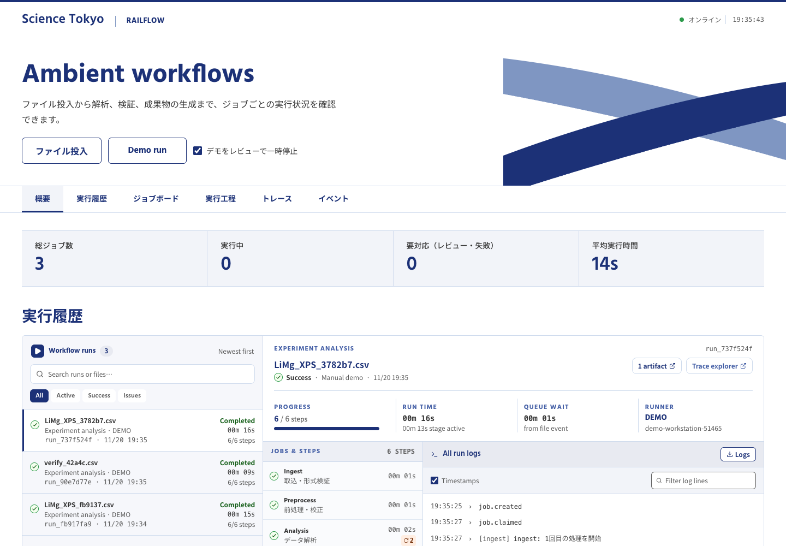

# RAILFLOW — Ambient Agent Workflow Observatory

[日本語](README.ja.md)

A local-first proof of concept for **pull-based Codex / Claude Code scientific-analysis jobs**, styled with the **Institute of Science Tokyo (東京科学大学 / Science Tokyo)** design system and built with **Node.js 26, pnpm 12, Vite+, React 19, TypeScript, and Tailwind CSS v4**.



The RAILFLOW header link opens the landing page (`/`). From there, select a project to access its workflow, jobs, and execution monitor.

- **Projects (`/projects`)** — create projects, edit their names and descriptions, and find their input and artifact directories. Select a project to open its details, workflow, jobs, and monitor.
- **Workflow (`/workflow`)** — edit no-code input triggers, per-stage/final acceptance checks, prompts, retry/timeout policies, and variable stage count (add/remove/reorder 1–20 stages), default and per-stage LLM model and reasoning effort (`--model`, `-c model_reasoning_effort` for Codex / `--effort` for Claude), and per-stage custom instructions saved to `data/projects.json` (`GET/POST /api/projects`, `PUT/DELETE /api/projects/:id`).
- **Jobs (`/jobs`)** — submit directories or multiple files as one dataset, or demo runs and track their status on the board. Select a job to open it in the execution monitor. [Job board](docs/board.png)
- **Actions / Runs & stage details** — a persistent run-history sidebar with Actions-style vertical step tabs and a single-grid right pane switching between **Summary** (LLM-generated `summary_<stage>.txt` with fallback to final agent output) and **Logs**, plus active/review/failed status filtering, collapsible attempts, timestamps, live durations, search, human review approval, and raw log download. [Step logs](docs/actions.png) · [Review gate](docs/review.png)
- **Trace explorer & events** — individual execution attempts rendered against elapsed time with Science Tokyo colors and visible status labels, and raw agent events. The artifact viewer opens on the selected job. Compare it with another job in the same project, preview HTML reports, or download presentations.

## Tech stack

- **Runtime**: Node.js 26+ (native TypeScript execution for `server.ts`, `worker.ts`, and `start-demo.ts`)
- **Package manager**: pnpm 12 (`packageManager: pnpm@12.21.0`)
- **Toolchain**: Vite+ (`vite-plus` / `vp` CLI — Vite 8 / Rolldown, Vitest, Oxlint, Oxfmt)
- **Frontend**: React 19 + TypeScript + Tailwind CSS v4 (`@tailwindcss/vite`)
- **Design system**: Science Tokyo palette (`#1c3177` Science Blue, `#7f96c2` Sub color, `#435ea5` Navy 700, `#f2f4f9` / `#e8eaf1` surfaces, WCAG 2.1 AA contrast), self-hosted **Noto Sans JP** & **Hind** fonts (`@fontsource/noto-sans-jp`, `@fontsource/hind`)

> **Note on official university logos:** Per the Science Tokyo Design System guidelines, no official university logo ("Science S" / logotype) is fabricated or embedded. Obtain official brand assets from the intranet-only Science Tokyo Design System if needed.

## Quick start (Node.js 26+, pnpm 12+)

```bash
pnpm install
pnpm run demo
# Open http://127.0.0.1:4173
# Click "Demo run" to generate a sample XPS-like CSV and execute six quicklook stages.
# Select 「デモをレビューで一時停止」 before starting to pause for human review. Shift + click also works.
```

For Vite HMR frontend development alongside the local API server:

```bash
pnpm run dev:server   # terminal A: HTTP API, inbox watcher, SSE stream on :4173
pnpm run dev          # terminal B: Vite+ dev server on :5173 (proxies /api and /artifacts)
pnpm run worker:demo  # terminal C: demo worker (or worker:codex / worker:claude)
```

## Scripts

```bash
pnpm run dev          # Start Vite+ dev server (vp dev)
pnpm run build        # Production frontend build into dist/ (vp build)
pnpm run start        # Run HTTP server serving dist/ and API (node server.ts)
pnpm run demo         # Build frontend and launch server + demo worker
pnpm run worker:demo  # Run demo pull worker
pnpm run worker:codex # Run Codex CLI pull worker
pnpm run worker:claude# Run Claude Code CLI pull worker
pnpm run check        # Format, lint, and type check (vp check)
pnpm run test         # Run Vitest suite (vp test run)
```

The demo worker creates a genuine `report.html` (styled with the Science Tokyo palette) and, if `python-pptx` is installed, a `report.pptx` using Yu Gothic. For a multi-file dataset it produces an HTML inventory and independent CSV/TSV quicklooks, without combining unrelated traces. It simulates a retry at the analysis stage to exercise the failure rail. **This is descriptive demo data processing, not a scientific XPS peak-fitting or peak assignment.**

The Codex and Claude workers write intermediate files and final reports in isolated `projects/<project-id>/work/<run-id>/.attempts/<stage>/<attempt>/` directories. Each attempt inherits only the last accepted checkpoint; failed output never contaminates a retry. After the final stage and any required approval, the worker copies the finished reports into `projects/<project-id>/artifacts/<run-id>/` and registers them in the dashboard. The agent only needs write access to its workspace.

## Datasets, conditions and execution policies

Use **Jobs → select multiple files / select a folder**, or drop a folder into the intake area. Review the relative paths, then submit one dataset as one job. Uploads are staged until every declared file has arrived; interrupted transfers cannot create partial jobs. Limits are 1000 files, 20 MiB per file, 200 MiB total, and 12 path levels. The watched inbox can process individual files, each immediate subdirectory recursively, or both.

**Workflow** provides a shared no-code condition builder for input triggers, each stage's output gate, and the final publication gate. Nest AND/OR groups and NOT, compare file presence/count/bytes, text contents, typed JSON fields, dataset names, and (for triggers) quiet time. Missing or malformed evidence is a third state, _unknown_, and NOT does not turn it into success. An OR with a passing alternative passes; the full evidence tree is retained. Try an unsaved trigger against a watched dataset without creating a job.

Project defaults and per-stage overrides control **additional retries**, retryable failure kinds, fixed/exponential delay, per-attempt timeout, cumulative stage budget, and stop/review behavior. A separate cumulative job budget applies across stages. Zero retries means one total attempt. Zero timeout removes that limit, while narrower parent limits still apply. Queue and review wait do not consume the active budget. Process groups are terminated before retrying; a timeout stays a failure even if the process exits zero after TERM.

Plain-text acceptance requirements are agent instructions. Automatic gates are evaluated by the server after execution; CLI exit code zero alone does not pass a configured gate. Review approval is tied to a specific stage, attempt and review event. Review outputs can be inspected before approval, and no report is published until all stages and the final gate have passed or been explicitly approved. Failed checks remain visible after an exception approval.

Prompts support named variables and a preview generated by the same builder used by the worker. Every new job snapshots its dataset manifest and complete workflow definition, so edits affect future jobs and cannot change a queued or reviewed run. Unchanged watched datasets are deduplicated across restarts; manual uploads can intentionally repeat a run.

See the [Japanese user guide](README.ja.md) and [schema, semantics, and API examples](docs/workflow-policies.md). Worker recovery and queue controls are described in [execution and recovery](docs/reliable-execution.md).

## File structure

```text
index.html           Vite HTML entry point
vite.config.ts       Vite+ unified config (React, Tailwind CSS v4, proxy, lint, fmt, test)
shared/types.ts      Shared TypeScript event/job domain types
src/                 React + TypeScript + Tailwind CSS dashboard UI
server.ts            fs.watch, job queue API, SQLite journal, SSE, static dist/ server
worker.ts            Pull worker (demo / Codex / Claude adapters)
start-demo.ts        Launches server.ts + demo worker
scripts/             Science Tokyo-styled quicklook HTML/PPTX report generator
tests/               Vitest API, event-replay, and helper tests
```

Set `PORT`, `HOST`, `RAILFLOW_HOME`, `RAILFLOW_URL`, `RAILFLOW_AGENT_TIMEOUT_MS`, and `RAILFLOW_PYTHON` for deployment differences. The demo is designed for **localhost only** (default bind `127.0.0.1`), and has **no authentication**.

### Reliable execution

The monitor supports pause/resume/cancel, queue priorities, concurrency limits,
and lease-based recovery from worker failure. See [execution and recovery](docs/reliable-execution.md)
for the protocol, SQLite journal migration and configuration.

### Workflow Engine v2

Opt into sequential or DAG scheduling, parallel file maps, explicit AI/command/Python/HTTP/human stages,
input/output contracts and selective reruns. Existing jobs retain their frozen execution model.
See [workflow engine](docs/workflow-engine.md) for configuration and examples.
