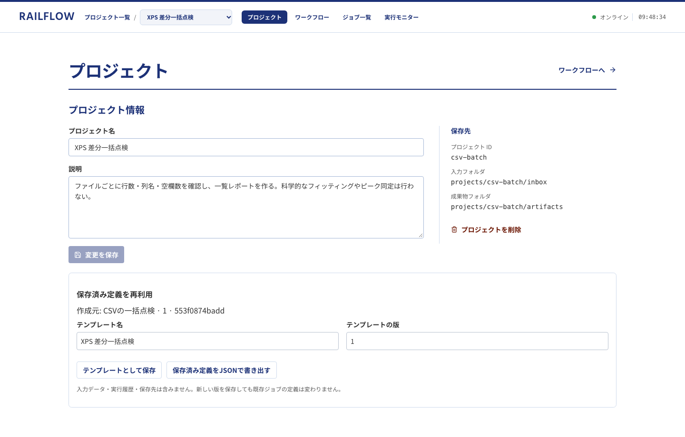
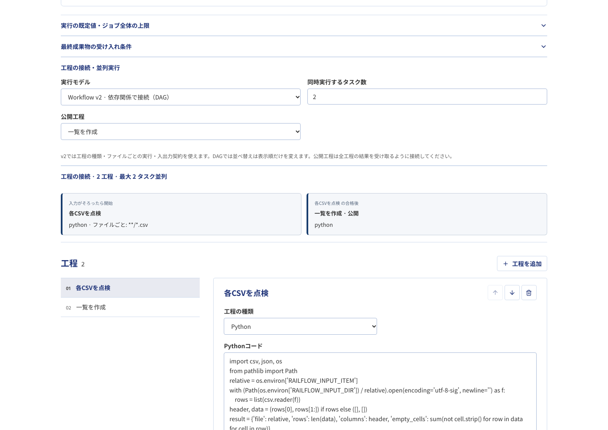
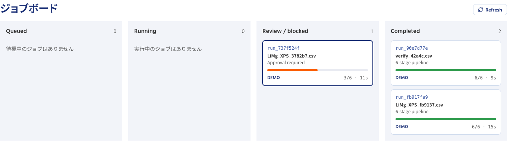
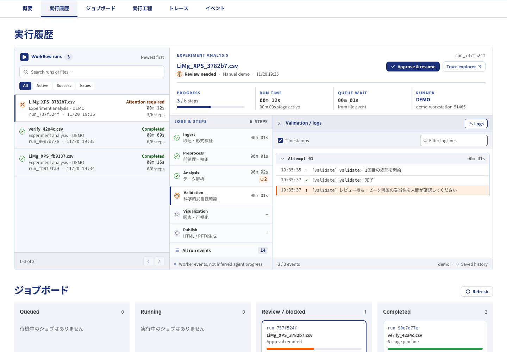
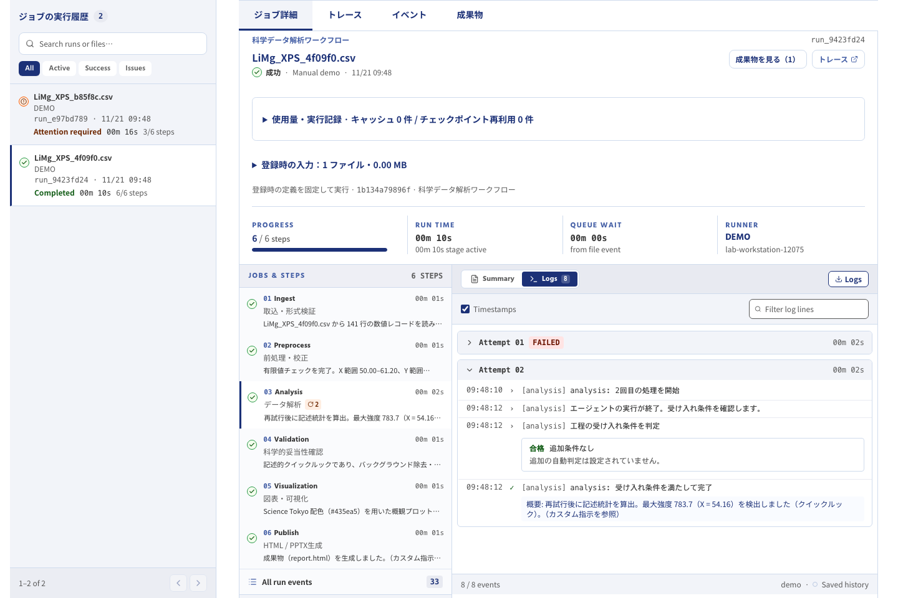

# RAILFLOW

[日本語](README.ja.md)

RAILFLOW is a local-first workflow runner and execution monitor for analyzing experimental data and reviewing per-stage outputs and execution records. Define an analysis workflow per project, and pull workers process single files, multiple selected files, or entire folders as a single job. It supports Codex CLI and Claude Code CLI, and the UI follows the **Institute of Science Tokyo (Science Tokyo)** design system (Noto Sans JP, Hind, and Science Blue).

> **Note on official logos:** Per the Science Tokyo Design System guidelines, no official university logo ("Science S" or logotype) is fabricated or embedded.


## Try the demo

Prepare Node.js 26+, pnpm 12, and Python 3. Because the demo worker generates reports with a local Python script, no Codex or Claude authentication is required.

```sh
pnpm install
pnpm run demo
```

1. Open [http://127.0.0.1:4173](http://127.0.0.1:4173) in a browser and open the default project from **Projects**.
2. On **Jobs**, click **Demo run**. A sample XPS-like CSV is submitted and its execution monitor opens.
3. Select a stage in **Job details**. **Summary** shows the stage summary, and **Logs** shows per-attempt records. In the default demo, the analysis stage fails once and retries automatically.
4. Once completed, open `report.html` under **Artifacts**. If `python-pptx` is installed in the demo Python environment, `report.pptx` is also available for download.

To try human review, check **デモをレビューで一時停止** (pause demo for review) before submitting—or Shift-click **Demo run**. When paused for review, inspect the target stage outputs and then approve to continue. Demo reports are descriptive quicklooks and do not perform scientific XPS peak fitting or peak assignment.

## Projects and templates

From **Projects**, click **New project**, enter a name and description, and create a project. In addition to the default setup, you can start from built-in templates (**CSVの一括点検** / **AI解析と人間の確認**), saved templates, or an external template JSON file. When an external JSON template includes command, Python, or HTTP stages or a custom Python executable path, the UI displays a full preview of the executable contents and requires explicit confirmation before creating the project.



Opening a project shows **Project**, **Workflow**, **Jobs**, and **Monitor** in the header. On **Project**, you can edit the project name and description, inspect its inbox and artifact directories, save the current saved workflow as a named and versioned template, or export it as JSON. Saved templates can be deleted from the catalog after confirming their name and revision. Exported and saved templates never include input data, run history, or local storage paths.

## Workflow definition

On **Workflow**, edit acceptance requirements and per-stage settings, then save with **Save definition**. If the same project is updated from another tab while you are editing, your unsaved draft is preserved with a notification letting you either load the latest version or explicitly overwrite. Switching projects or leaving the page with unsaved edits also prompts for confirmation.



### Execution models and stage types

Alongside the default legacy sequential model, Workflow v2 supports **sequential** and **dependency-based (DAG)** scheduling. The default 6 stages (ingest/validation, preprocessing/calibration, analysis, scientific validation, visualization, and report generation) can be added, removed, or reordered between 1 and 20 stages.

| Item                             | Details                                                                                                                                         |
| -------------------------------- | ----------------------------------------------------------------------------------------------------------------------------------------------- |
| Execution models                 | Legacy sequential / Workflow v2 (sequential or DAG, up to 8 parallel tasks)                                                                     |
| Stage types (v2)                 | AI (worker default, Codex, Claude) / Command / Python / HTTP / Human approval                                                                   |
| Per-file processing (map)        | Expands matching files into separate tasks; enable isolated input to pass only the matched file                                                 |
| Input/output file contracts (v2) | Validates file count ranges and JSON schemas per pattern, with readable summaries of all active constraints (numeric bounds, array items, etc.) |

Drafts are preserved when switching between execution models or stage runner kinds. When saving would discard incompatible settings, the UI shows the number of affected stages and the settings to be dropped for confirmation. Model name and reasoning effort are resolved in order: stage setting, project default, then CLI default.

### Inputs and trigger conditions

Under **Inputs and trigger conditions**, choose the watched inbox unit (individual files, immediate subdirectories, or both) and the quiet wait time (default 1.5s). Build nested **AND**, **OR**, and **NOT** condition groups comparing file presence, file count, total bytes, text contents, typed JSON values, dataset name, and quiet time.

`*.csv` matches files in the top level, while `**/*.csv` includes subdirectories. JSON keys such as `quality.score` distinguish strings, numbers, and booleans. Missing keys, malformed JSON, and type mismatches evaluate to _unknown_, and **NOT** does not convert _unknown_ into pass. An **OR** group passes if another branch passes, while retaining the full evaluation breakdown.

Use **Test unsaved conditions** to evaluate the condition against real watched inputs without creating a job. Waiting or unknown reasons appear in the inbox status panel on **Jobs**. Manual uploads treat completed transfer as quiet and evaluate all other trigger conditions; only **Demo run** skips trigger checks.

### Stage gates, retries, and timeouts

Project-wide and per-stage acceptance requirements are plain-text instructions passed to agents. Stage automatic gates and final publication gates are evaluated by the server against output files after execution (text and JSON checks apply to regular files up to 2 MiB). Exit code 0 alone does not pass a failing or unknown automatic gate.

Configure project defaults under **Execution defaults**, and toggle per-stage overrides to customize individual stages.

| Setting                 | Meaning and default                                                                                          |
| ----------------------- | ------------------------------------------------------------------------------------------------------------ |
| Additional retries      | Retries added after the first attempt (`0` = 1 attempt total, `2` = up to 3 attempts). Default `1`, max `10` |
| Per-attempt timeout     | Default `1500`s (25 min). `0` removes the limit                                                              |
| Cumulative stage limit  | Sum of all attempts and retry waits for a stage. Default `0` (unlimited)                                     |
| Cumulative job limit    | Cumulative active time across stages. Default `0` (unlimited)                                                |
| Retry delay and backoff | Default `0.5`s fixed. Exponential backoff available up to 1 hour                                             |
| Retryable failures      | Choose among execution error, attempt timeout, and acceptance gate failure                                   |
| On retry exhaustion     | Stop the job as failed, or wait for human review                                                             |

Active stage and job budgets include workspace preparation, CLI execution, gate evaluation, pre-publication report checks, and retry waits; they exclude intake, queue wait, human review wait, and post-approval publication copies. On timeout, the process group is terminated and reaped before retrying. Failed attempt outputs are isolated so retries always start from the last accepted checkpoint. Deterministic failures (such as template syntax errors or tampered input snapshots) stop immediately without retrying.

### Prompt variables, runtime environment, and caching

Common prompts, stage instructions, and acceptance requirements support variables such as `{{dataset.name}}`, `{{input.count}}`, `{{input.directory}}`, `{{input.manifest}}`, and `{{retry.reason}}`. Check available variables and rendered previews in **Prompt variables & preview**; the exact prompt sent at runtime is also recorded in the monitor.

Under runtime environment settings, declare an existing virtualenv Python path, expected Node / Python / AI CLI versions, and pinned Python package versions. Mismatches or missing metadata are caught before running code; RAILFLOW does not automatically provision environments.

Result caching is opt-in per stage. When inputs, workflow definition, and observed runtime match a previously accepted run, outputs are hash-verified and restored, while current acceptance gates and any required human approvals still run every time. Enabling isolated input on map stages allows incremental processing by reusing unchanged file results.

## Submitting jobs and queue controls

On **Jobs**, select or drop multiple files or folders to submit one dataset as one job, preserving relative paths (such as `sample_A/data.csv` and `sample_B/data.csv`). Limits are 1,000 files, 20 MiB per file, 200 MiB total, and 12 directory levels. Symlinks, hard links, and parent directory traversal are rejected. If a second file selection or drop fails validation, the previously valid selection and dataset name are preserved.



Jobs are organized into four columns: **Queued / Paused**, **Running**, **Needs approval**, and **Completed** (displaying separate counts for succeeded, failed, and cancelled runs), with a direct jump link to **Needs approval** at the top of the page. Search matches dataset name, included relative file paths, job ID, agent name, or worker ID, including collapsed cards.

Input manifests and workflow definitions are snapshotted at job creation, so later workflow edits never alter queued or review-waiting runs. Unchanged watched inbox inputs are deduplicated across restarts, while manual uploads always enqueue a new run.

### Queue settings and execution controls

The **Queue** panel configures global concurrency (`1–32`), per-worker limit (`1–16`), and automatic recovery limit (`0–20`). Per-job priority (`-100–100`), pause/resume, and confirmed **Cancel job** controls are available directly in the UI. For stopped Workflow v2 jobs, you can selectively rerun a chosen task and its downstream dependents as a new job—recomputing selected tasks without cache while keeping the original job and history intact.

### Starting Codex / Claude Code workers

Install and authenticate the CLI you plan to use in the same terminal. Stop the demo if running (`Ctrl+C`), build the frontend, and start the server:

```sh
pnpm run build
pnpm start
```

Start a worker in another terminal:

| CLI             | Command                  |
| --------------- | ------------------------ |
| Codex CLI       | `pnpm run worker:codex`  |
| Claude Code CLI | `pnpm run worker:claude` |

Use `RAILFLOW_PROJECT=xps pnpm run worker:codex` to scope a worker to one project, and pass `--concurrency=2` (`1–16`) for parallel job slots. Running the demo worker alongside a CLI worker may cause the demo worker to claim jobs first.

## Execution monitor, review approval, and provenance

The left sidebar lists run history for the selected project; picking another run switches details, traces, events, and artifacts together.

### Human review approval

Enabling per-stage review or final pre-publication review pauses the stage in **Needs approval**. Even while sibling branches are still running in Workflow v2, review-waiting tasks are counted under **Needs approval** and can be opened directly from the top button or DAG graph cards.



Inspect the attempt's output files from stage details before approving. Approvals are bound to a specific stage, attempt, and review sequence so an approval cannot carry over to another stage. When failure handling is set to wait for human review, failed gate results remain visible while allowing an explicit exception approval. Stage/job timeouts and worker interruptions cannot be exception-approved.

### Logs, traces, usage, and artifact comparison

Switch between **Summary** and **Logs** per stage under **Job details**. **Logs** supports collapsible attempts, timestamps, line filtering, and full-job log downloads.



| What to inspect                          | Where to open                                                                          |
| ---------------------------------------- | -------------------------------------------------------------------------------------- |
| Stage summary and gate checks            | Select a stage in **Job details** → **Summary**                                        |
| Per-attempt logs and failure cause       | **Job details** → **Logs** (expand attempts, filter, or download)                      |
| Token usage, estimated cost, cache reuse | **Job details** → **Usage & provenance** (compare runs or export provenance JSON)      |
| Stage timing breakdown                   | **Trace** tab                                                                          |
| Chronological event log                  | **Events** tab                                                                         |
| Artifact preview and run comparison      | **Artifacts** tab → **Single view** or **Compare jobs** (HTML preview / PPTX download) |

**Usage & provenance** reports collected tokens (including retries), rate-table cost estimates with coverage scope, and cache/checkpoint reuse counts. Missing usage or unconfigured rates are never treated as zero. The run comparison table shows per-task output hashes, durations, and cost coverage by stage label and relative file path.

## CLI and MCP server

Alongside the web UI, RAILFLOW provides a terminal CLI (`cli.ts`) for scripts and operators, and a stdio MCP server (`mcp.ts`) for AI agents. Both run on Node.js 26+ built-in modules with no additional dependencies.

### CLI (`railflow`)

Run via `node cli.ts`, `./cli.ts`, or `pnpm run cli <command> [options]`. The default target is `http://127.0.0.1:4173`. When the server runs on another port (for example `PORT=4310`), set `--server URL` or `RAILFLOW_SERVER`.

```sh
# Check the default server (http://127.0.0.1:4173)
node cli.ts health
node cli.ts projects list

# Target a server on another port, submit a directory, and watch progress
RAILFLOW_SERVER=http://127.0.0.1:4310 node cli.ts submit ./samples/run1 --project xps --watch

# Inspect a review-waiting stage and approve it with its exact server receipt
node cli.ts review list JOB_ID --stage analysis
node cli.ts review read JOB_ID --stage analysis --attempt 1 --sequence 1 --path summary.json
node cli.ts review approve JOB_ID --stage analysis --attempt 1 --sequence 1 --receipt TOKEN --yes

# Download artifacts and provenance (existing files are never overwritten)
node cli.ts artifacts get JOB_ID --name report.html --out ./report.html
node cli.ts jobs provenance JOB_ID --out ./provenance.json
```

Run `node cli.ts --help` to list all commands. Key safety guarantees:

- `RAILFLOW_PROJECT` sets the default project for read commands (`projects get`, `jobs list`, etc.), while mutating commands targeting an existing project require an explicit positional project ID or `--project`.
- `projects update` and `workflow set` require `--expected-updated-at` for optimistic concurrency and exit with code `5` (HTTP 409) on conflict.
- `review approve` requires the exact `--attempt`, `--sequence`, and `--receipt` from `review list` plus `--yes` (and `--exception` when approving a failed stage as an exception).
- Binary responses are blocked from writing raw bytes to a TTY (`--out FILE` is required), and file downloads never overwrite an existing file.
- Sending `SIGINT` to `jobs wait` or `--watch` exits the CLI with code `130` while leaving the job and workers running on the server.

| Exit code | Meaning                                                                 |
| --------- | ----------------------------------------------------------------------- |
| `0`       | Success (`done` for `jobs wait` / `--watch`)                            |
| `1`       | Unexpected internal error                                               |
| `2`       | Usage, argument, or local input validation error                        |
| `3`       | Connection or transport failure                                         |
| `4`       | HTTP error (other than 409/422), protocol mismatch, or size limit error |
| `5`       | Conflict (HTTP 409: optimistic concurrency or state mismatch)           |
| `6`       | Validation failure (HTTP 422, or `inputs check` fail/error)             |
| `7`       | Job ended in `failed` or `cancelled`                                    |
| `8`       | Job paused or a stage awaits review                                     |
| `9`       | Timeout (HTTP request or `jobs wait --timeout-ms`)                      |
| `10`      | Outcome unknown (transport drop after sending a mutation)               |
| `130`     | Interrupted by `SIGINT`                                                 |

### MCP server (`railflow-mcp`)

Implements MCP protocol `2025-11-25` over stdio using newline-delimited JSON-RPC 2.0. Configure MCP hosts to invoke `node /abs/path/to/mcp.ts` or `node /abs/path/to/cli.ts mcp` directly; `pnpm mcp` is for manual development checks only because package-manager stdout output can corrupt JSON-RPC framing.

```json
{
  "mcpServers": {
    "railflow": {
      "command": "node",
      "args": [
        "/abs/path/to/ambient-rail-monitor/mcp.ts",
        "--upload-root",
        "/abs/path/to/datasets"
      ],
      "env": {
        "RAILFLOW_SERVER": "http://127.0.0.1:4173"
      }
    }
  }
}
```

- At its deadline, `railflow_job_wait` returns the last observed job with `reached:false`. If the API has not supplied a snapshot yet, the tool returns a timeout error.
- Discovery (`initialize`, `tools/list`, `resources/list`, `resources/templates/list`) succeeds even when the API server is offline.
- By default, 32 tools are exposed for reads, execution control, review, templates, and queue management. Passing the absolute path of a trusted staging directory to `--upload-root DIR` adds `railflow_dataset_submit` and session-scoped `railflow_upload_commit` (34 tools total). Only the operator should be able to rename or replace directories in this tree. Selected paths must stay within the root and cannot traverse symlinks or include hard-linked files.
- Tool responses are capped at 32 KiB with pagination and byte-offset previews, pointing to CLI fallback commands when full logs or artifacts are needed. Read-only access is also provided via 3 static resources (`railflow://projects`, `railflow://queue`, `railflow://templates`) and 6 URI templates (`railflow://projects/{projectId}`, `/jobs`, `railflow://jobs/{jobId}`, `/logs`, `/provenance`, `/artifacts`).
- `railflow_review_approve` only approves the exact attempt matching the receipt from `railflow_review_list`. Hosts should display `jobId`, `stageKey`, `attempt`, `failureKind`, and `exception` and confirm with a human before calling it.

## Data storage layout

Paths are relative to the repository root unless `RAILFLOW_HOME` is set when starting the server.

| Path                                                               | Contents                                                                                                                                    |
| ------------------------------------------------------------------ | ------------------------------------------------------------------------------------------------------------------------------------------- |
| `data/projects.json`                                               | Project settings and workflow definitions (partially unreadable files are backed up to `.corrupt-<ts>` while preserving unreadable entries) |
| `data/journal.sqlite`                                              | SQLite database for event journal, lease state, queue settings, and saved templates                                                         |
| `data/events.jsonl`                                                | Event log exported from the SQLite journal                                                                                                  |
| `data/cache/`                                                      | Verified stage output cache (pruned oldest-first beyond 512 MiB / 256 entries)                                                              |
| `data/inputs/<job-id>/`                                            | Input dataset snapshot taken at job creation (preserving relative paths)                                                                    |
| `data/manifests/<job-id>.json`                                     | Relative paths, byte sizes, and SHA-256 hashes of all inputs                                                                                |
| `projects/<project-id>/inbox/`                                     | Watched inbox directory                                                                                                                     |
| `projects/<project-id>/work/<job-id>/.attempts/<stage>/<attempt>/` | Isolated per-attempt workspace                                                                                                              |
| `projects/<project-id>/artifacts/<job-id>/`                        | Published reports after final stage and required reviews                                                                                    |

## Development and configuration

The frontend uses React 19, TypeScript, TanStack Query, Tailwind CSS v4, and the Vite+ (`vp`) toolchain. Job updates stream from the server over SSE.

For live frontend development alongside the API server, run in separate terminals and open [http://127.0.0.1:5173](http://127.0.0.1:5173):

```sh
pnpm run dev:server   # API server, inbox watcher, SSE (:4173)
pnpm run dev          # Vite+ dev server (:5173, proxies /api and /artifacts)
pnpm run worker:demo  # Demo worker (or worker:codex / worker:claude)
```

### Common commands

```sh
pnpm run check   # Format, lint, and type check (vp check)
pnpm run test    # Run Vitest suite (vp test run)
pnpm run build   # Production frontend build into dist/
pnpm run start   # Serve dist/ and API in production mode
pnpm run cli health  # Run the CLI (or invoke node cli.ts directly)
pnpm run mcp            # Manual MCP check (use node mcp.ts in MCP host configs)
```

### Environment variables and security notes

| Variable                    | Purpose and default                                                                                                   |
| --------------------------- | --------------------------------------------------------------------------------------------------------------------- |
| `HOST` / `PORT`             | API server bind address. Default `127.0.0.1:4173`                                                                     |
| `RAILFLOW_ALLOWED_HOSTS`    | Allowed `Host` header values when accepting remote connections such as `HOST=0.0.0.0` (comma-separated, no wildcards) |
| `RAILFLOW_HOME`             | Root directory for data and project folders. Default repository root                                                  |
| `RAILFLOW_URL`              | API URL used by workers and the Vite dev proxy. Default `http://127.0.0.1:4173`                                       |
| `RAILFLOW_SERVER`           | API URL used by the CLI and MCP server. Default `http://127.0.0.1:4173`                                               |
| `RAILFLOW_PROJECT`          | Project filter for workers and default project for CLI reads                                                          |
| `RAILFLOW_AGENT_TIMEOUT_MS` | Optional additional execution timeout cap in milliseconds (minimum of this and workflow setting applies)              |
| `RAILFLOW_PYTHON`           | Default Python executable for demo reports and Python stages. Default `python3`                                       |
| `RAILFLOW_ALLOW_LOCAL_EXEC` | Set to `1` to allow command, Python, HTTP, and external AI stages under `--mode=demo` (blocked by default)            |

RAILFLOW has no authentication and is designed for local use by default. The API validates `Host`, `Origin`, `Sec-Fetch-Site`, and `Content-Type` against DNS rebinding and CSRF, and HTTP stages block link-local/metadata IPs and Railflow's own API port. If you bind `HOST=0.0.0.0` on a trusted network, list the allowed hostnames or IPs in `RAILFLOW_ALLOWED_HOSTS`.

## Compatibility and specifications

Existing project definitions automatically receive defaults for new fields, and legacy event formats and single-file APIs remain readable. If a running worker crashes or is forcibly terminated, its lease expires and the server automatically recovers the job while keeping accepted stages (counting against the recovery budget). Planned `SIGINT` / `SIGTERM` stops interrupt the active attempt and requeue the job without spending the recovery budget.

Detailed specifications, API schemas, and constraints are documented in:

- [Workflow policies, conditions, and execution limits](docs/workflow-policies.md)
- [Execution recovery, leases, and queue controls](docs/reliable-execution.md)
- [Workflow Engine v2 (DAG, contracts, selective reruns)](docs/workflow-engine.md)
- [Reusable templates, caching, and provenance](docs/reusable-pipelines.md)
