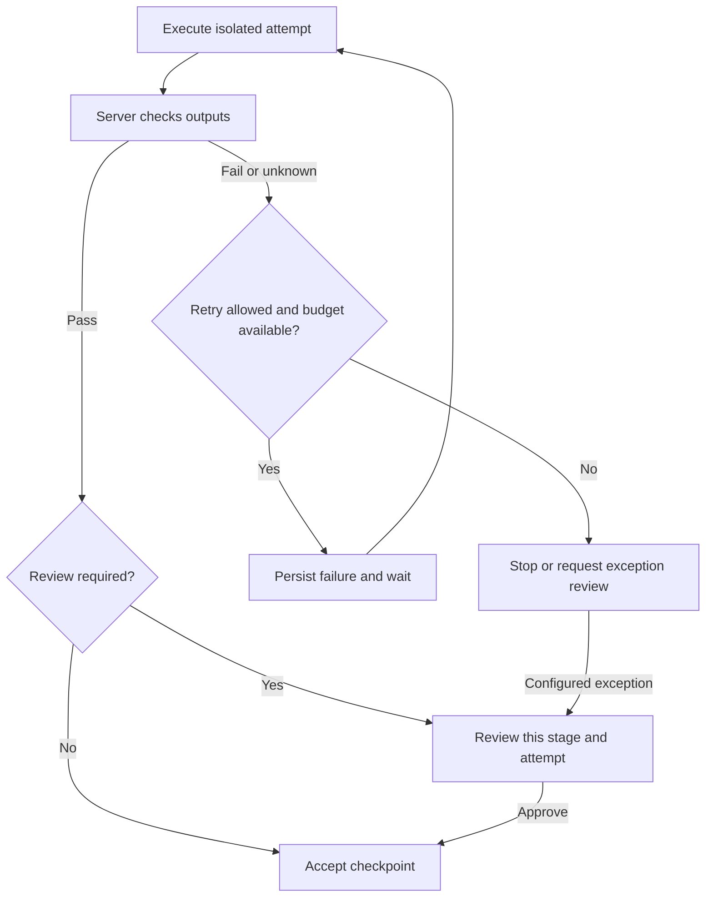

# Dataset workflows and execution policies

## Registration and immutable inputs

A job is one named dataset: a single file, a manually selected file set, or an immediate inbox directory including its descendants. Relative paths are POSIX paths on every host. Input inventory is sorted; each file has its byte count and SHA-256. Directory identity is SHA-256 of the ordered file manifest. A single file retains its content hash for compatibility.

The server copies and hashes the same bytes into a temporary snapshot, verifies that the source inventory stayed stable, then atomically renames the snapshot. No `job.created` event is written until the complete snapshot and trigger checks pass. The event records both the manifest and a versioned/hash-addressed copy of the entire project definition. Claim and review resumption use this copy. `data/manifests/<job-id>.json` supplies the agent with every input path, including files omitted from the 20-file prompt preview.

Watched input identity is project + origin + relative dataset name + content hash. Unchanged content is deduplicated after a restart, and changing only the workflow does not replay existing inputs. A manual upload has its own submission ID, permitting intentional repeated analysis. Upload commit is idempotent within its session.

### Limits

| Scope                             | Limit                                                   |
| --------------------------------- | ------------------------------------------------------- |
| Dataset                           | 1000 files, 20 MiB per file, 200 MiB total, 12 levels   |
| Automatic output inventory        | 5000 files, 512 MiB per file, 1 GiB total, 12 levels    |
| Text / JSON check                 | 2 MiB per referenced regular file                       |
| Condition tree                    | 64 nodes, 5 levels including NOT, 12 children per group |
| Stages                            | 1–20                                                    |
| Additional retries                | 0–10                                                    |
| Attempt / stage / job limit       | 0–7 days; 0 removes this limit                          |
| Retry delay                       | 0–1 hour, including exponential cap                     |
| Watch stability / quiet predicate | 0–24 hours                                              |
| Uncommitted upload sessions       | 16 active, expire after 30 minutes without activity     |

Symlinks, hardlinks, special files, absolute paths, parent traversal and ambiguous upload path collisions are rejected. Uncommitted transfers are outside watched inboxes and discarded on server restart. Empty files are allowed within nonempty datasets (for example `.ready`); an empty directory is not a dataset.

For an acquisition process writing files over time, use a ready marker or expected file count in addition to the stability interval. An idle interval alone cannot predict that another file will arrive later. Manual commit means the declared transfer is complete, so both stability and quiet predicates are satisfied immediately; other predicates still apply. `POST /api/demo` bypasses input triggers only, and still follows the frozen execution/acceptance settings.

## Condition language

The visual editor and API use the same bounded AST. There is no JavaScript evaluation or user-supplied regular expression. Glob matching uses bounded dynamic programming rather than a backtracking regex.

| `op`                       | Fields / meaning                                          |
| -------------------------- | --------------------------------------------------------- |
| `all`, `any`               | `children: Condition[]`; AND / OR                         |
| `not`                      | `child: Condition`; logical negation                      |
| `file.exists`              | `pattern`                                                 |
| `file.count`, `file.bytes` | `pattern`, `compare`, integer `value`                     |
| `file.contains`            | relative `path`, literal `text`                           |
| `json.value`               | relative `path`, dotted `field`, `compare`, typed `value` |
| `name.contains`            | literal `value`, matches dataset name                     |
| `quiet`                    | integer `seconds`; input triggers only                    |

`compare` is `eq`, `ne`, `gt`, `gte`, `lt`, or `lte`. Ordering requires numbers. JSON types are never coerced; `"1"` differs from `1`. Dotted keys may address array indices, but keys containing dots cannot be escaped in this version. `*` and `?` stay in a path segment; `**` crosses directories; `**/*.csv` includes root-level CSVs.

Evaluation returns a tree of `pass`, `fail`, or `error`, labels and measured values. Missing JSON keys/files, invalid JSON and type mismatches produce `error`. `NOT(error)` stays `error`. AND is false if any child is false; OR is true if any child is true; otherwise an error propagates. Every child result is kept, including an unused OR alternative. `condition: null` explicitly disables additional automatic checks; an empty group is invalid.

## Project definition example

Send this as part of `POST /api/projects` or `PUT /api/projects/:id`. An existing project can omit unchanged project-level properties. Each supplied stage is a complete definition, and its `execution` contains only overrides.

```json
{
  "name": "XPS batch analysis",
  "prompt": "Compare all {{input.count}} files in {{dataset.name}}. Read the full input manifest.",
  "input": {
    "mode": "directory",
    "settleMs": 1500,
    "condition": {
      "op": "all",
      "children": [
        { "op": "file.count", "pattern": "**/*.csv", "compare": "gte", "value": 2 },
        { "op": "file.exists", "pattern": ".ready" }
      ]
    }
  },
  "execution": {
    "maxRetries": 2,
    "attemptTimeoutMs": 600000,
    "stageTimeoutMs": 1800000,
    "retryDelayMs": 1000,
    "backoff": "exponential",
    "retryOn": ["execution_error", "timeout", "acceptance_failed"],
    "onFailure": "stop"
  },
  "jobTimeoutMs": 3600000,
  "stages": [
    {
      "key": "analyze",
      "label": "Analysis",
      "short": "Analyze",
      "instruction": "Write metrics.json with quality.passed, and generate the final report.",
      "acceptanceCriteria": "Explain any missing units; do not infer experimental conditions.",
      "llm": { "model": "", "effort": "" },
      "execution": { "maxRetries": 1 },
      "gate": {
        "condition": {
          "op": "json.value",
          "path": "metrics.json",
          "field": "quality.passed",
          "compare": "eq",
          "value": true
        },
        "requireReview": false
      }
    }
  ],
  "finalGate": {
    "condition": { "op": "file.exists", "pattern": "report.html" },
    "requireReview": true
  }
}
```

Defaults: automatic file/directory input, 1500 ms stability, no additional predicates, one additional retry, 25-minute attempt limit, unlimited stage/job budgets, 500 ms fixed delay, retry on the three failure categories, and stop after exhaustion. Overrides preserve explicit zero. `RAILFLOW_AGENT_TIMEOUT_MS`, when a positive finite number, adds a worker-side attempt cap; it never lengthens a configured limit.

## Execution, review and publication



An attempt starts from the latest accepted stage workspace, never the previous failed attempt. Executable owner permissions on accepted scripts are retained. The input snapshot is separate and verified before/after agent execution. Final reports inherited from earlier stages are archived as drafts so the final stage must produce its own nonempty `report.html` and/or `report.pptx`.

The worker records `stage.started → stage.executed → gate.evaluated → stage.succeeded` or `review.required`. The final stage evaluates both its stage gate and the final gate. The server computes gate evidence from the frozen definition and the recorded attempt directory; a submitted result cannot override the actual files. A missing/nonempty-report check still applies when no additional condition is set. No artifact is registered/served before all stages are accepted.

Failures record a category and duration. Retrying requires both a selected failure category and a remaining additional retry. Aggregate stage/job timeouts and worker interruption never retry or enter exception review. Backoff that would exhaust the remaining aggregate budget stops immediately. Queue/review wait does not consume budgets; attempt preparation, execution, validation and actual retry wait do. Final publication copies after acceptance are outside this active-stage budget. SIGTERM is followed by SIGKILL after a one-second grace on POSIX, targeting the process group. Windows uses `taskkill /T /F`; process-tree regression tests run on POSIX. Log flushing is bounded and does not retain abandoned child processes.

Each review stores its stage, attempt and event sequence. Approval accepts that exact workspace and enqueues continuation. Multiple stages can require separate approvals. For `onFailure: review`, approval is an explicit override, not a successful automatic check: failure evidence remains in the job and logs. A final approved workspace still needs valid report files for publication. Review files are available through a sequence-bound sandboxed preview route before public artifact registration.

## API additions

| Method / route                                        | Purpose                                                                                                |
| ----------------------------------------------------- | ------------------------------------------------------------------------------------------------------ |
| `POST /api/uploads`                                   | Start a batch: `{projectId, name, kind, files: [{path, bytes}]}`                                       |
| `PUT /api/uploads/:id/files?path=...`                 | Raw bytes for one declared relative path                                                               |
| `POST /api/uploads/:id/commit`                        | Validate all transfers and trigger; return `{job}` or 422 with evidence                                |
| `DELETE /api/uploads/:id`                             | Discard a completed/cancelled transfer session                                                         |
| `POST /api/projects/:id/check-input`                  | Test `{name, origin: "project" or "legacy", condition}` against a watched input without registering it |
| `GET /api/state?project=...`                          | Includes input candidates/status, dataset/config snapshots, budgets and gate evidence                  |
| `GET /api/jobs/:id/review`                            | List output files for the current review                                                               |
| `GET /api/jobs/:id/review/file?path=...&sequence=...` | Open the exact reviewed output                                                                         |
| `POST /api/jobs/:id/approve`                          | `{stage, attempt, reviewSequence}`; stale/mismatched approvals return 409                              |

The legacy single-file `/api/upload` and `/api/workflow` APIs remain available. Old event logs without snapshots retain their old stage definitions and input/workspace recovery. They cannot reconstruct a historical full workflow definition and are labeled accordingly. This prototype does not automatically reclaim jobs after an abruptly killed worker or machine; it does durably resume explicit review checkpoints.

## Prompt variables

Supported in project `prompt`, stage `instruction` and stage `acceptanceCriteria`:

`{{project.name}}`, `{{job.id}}`, `{{dataset.name}}`, `{{input.directory}}`, `{{input.files}}`, `{{input.count}}`, `{{input.manifest}}`, `{{workspace}}`, `{{stage.key}}`, `{{stage.name}}`, `{{attempt}}`, `{{retry.reason}}`.

Expansion is one pass. Unknown variables prevent saving. `input.files` is a JSON list of up to 20 relative paths; the manifest lists all files. Project purpose and project-wide acceptance prose are literal text. Preview uses the worker's prompt builder with clearly marked example paths; the actual expanded prompt is recorded with each attempt.
